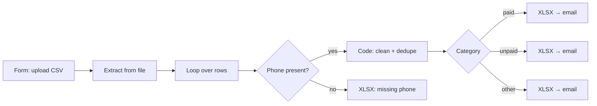

# Student Data ETL Pipeline (n8n)

> Upload a messy CSV and get clean, categorised Excel reports in your inbox.

 

## Overview

An **extract → transform → load** pipeline in n8n. A form accepts a raw student enrolment CSV. Rows without a phone number are separated out; the rest are cleaned in a JavaScript node (deduplication by student ID or email, title-case names, email validation), routed by fee category, converted to Excel files and emailed.

## Features

- Form upload of a raw CSV
- Deduplication by student ID or email
- Name normalisation and email validation
- Routing by category: **paid**, **unpaid**, other
- Excel (`.xlsx`) output per category, emailed automatically
- Rows missing a phone number exported separately

## How it works



## Tech stack

| Layer | Technology |
|---|---|
| Automation | n8n |
| Transform | JavaScript Code node, Switch, If |
| Output | Excel files via email (SMTP) |

## Project structure

```text
.
├── My workflow.json                  # n8n workflow export
└── student_enrollment_raw (1).csv    # sample raw input
```

## Getting started

**Prerequisites:** a running [n8n](https://n8n.io) instance (n8n Cloud or self-hosted)

1. Download `My workflow.json` from this repository.
2. In n8n, open **Workflows → Import from File** and choose the JSON file.
3. Open each node that needs an account and connect your own credentials (listed below). The export contains no secrets, only credential names.
4. Click **Execute workflow** to test, then **Activate** it.

## Usage

Open the form URL, upload `student_enrollment_raw (1).csv`, and check your inbox for the categorised reports.

## Notes

- Credentials to connect: SMTP (Send Email nodes). Set your own from/to addresses in the three email nodes.

## License

Released under the [MIT License](LICENSE).

## Author

**Prasanth Sundararajan**, Senior SRE and AI Engineer  
[LinkedIn](https://www.linkedin.com/in/prasanth-s-a093a7109/) · [GitHub](https://github.com/prasanth-sundararajan)
